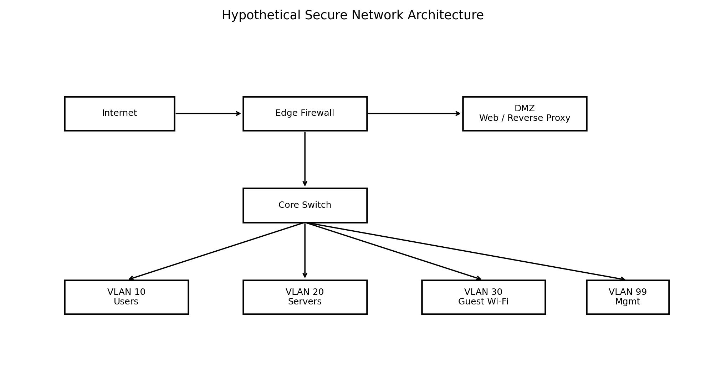
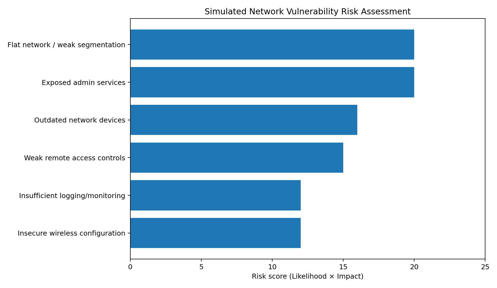

# Week 2 — Network Security Configuration & Vulnerability Assessment


> A defensive review of a hypothetical organizational network, simulated security findings, and recommended network-hardening controls.

## Executive Summary

This Week 2 assignment reviews a proposed network architecture and identifies common configuration weaknesses that could affect confidentiality, integrity, and availability. The exercise focuses on segmentation, administrative access, remote access, device maintenance, wireless security, and centralized logging.

The scenario is hypothetical. The findings are assessment examples for this assignment; this README does not claim that a live organization or production network was scanned or tested.

## Contents

- [Objectives](#objectives)
- [Assessment scope](#assessment-scope)
- [Proposed network architecture](#proposed-network-architecture)
- [Simulated findings](#simulated-findings)
- [Assessment workflow](#assessment-workflow)
- [Recommended security controls](#recommended-security-controls)
- [Hardening checklist](#hardening-checklist)
- [Improvement roadmap](#improvement-roadmap)
- [Repository contents](#repository-contents)
- [References](#references)
- [Ethical and legal scope](#ethical-and-legal-scope)

## Objectives

- Review a segmented network architecture.
- Identify common network-security weaknesses.
- Consider the likelihood and potential impact of each finding.
- Recommend firewall, VLAN, VPN, wireless, and administrative-access controls.
- Develop a network-hardening approach.
- Define validation activities for security improvements.

## Assessment Scope

| Area | Review focus |
|---|---|
| Perimeter | Firewall/NAT placement and traffic-control policy |
| User network | Separation of user endpoints from sensitive systems |
| Server network | Restricted access to server resources |
| Guest Wi-Fi | Isolation from corporate resources |
| Management network | Restricted administrative access |
| Remote access | VPN security and stronger authentication |
| Monitoring | Centralized event and configuration visibility |

The assessment is based on a hypothetical network design and simulated findings. It is not a configuration audit of a real environment.

## Proposed Network Architecture

The proposed design separates user, server, guest wireless, and management traffic using VLANs and controlled routing.

```text
                    INTERNET
                       |
                       v
              +-----------------+
              | FIREWALL / NAT  |
              |   ACL - VPN     |
              +--------+--------+
                       |
                       v
                +-------------+
                | CORE SWITCH |
                +------+------+
                       |
          +------------+------------+
          |            |            |
          v            v            v
       VLAN 10       VLAN 20      VLAN 30
        USERS        SERVERS      GUEST Wi-Fi
          |            |
          +------------+------+
                              |
                              v
                         VLAN 99
                        MANAGEMENT
```



The diagram is a proposed logical layout. Actual VLAN IDs, routing rules, and permitted flows must be defined and validated against an authorized environment's requirements.

## Simulated Findings

| ID | Finding | Priority | Security concern |
|---|---|---|---|
| F-01 | Weak network segmentation | Critical | Unnecessary paths between network zones |
| F-02 | Exposed administrative services | Critical | Management interfaces may be reachable too broadly |
| F-03 | Outdated network-device firmware | High | Known defects may remain unaddressed |
| F-04 | Weak remote-access controls | High | Remote access may lack strong authentication or restrictions |
| F-05 | Insufficient centralized logging | High | Reduced visibility for investigation and monitoring |
| F-06 | Insecure wireless configuration | High | Guest and corporate wireless access may not be adequately separated |



The priority labels are qualitative classifications from the exercise. Numeric likelihood and impact values are not provided in this README and are therefore not inferred.

## Assessment Workflow

**Asset review → architecture analysis → configuration review → vulnerability identification → risk prioritization → security recommendations → validation and monitoring.**

### Risk Model

**Risk = Likelihood × Impact**

Findings are prioritized by considering potential business impact and likelihood of exploitation. Any real assessment should document its scoring criteria and evidence.

## Recommended Security Controls

| Control area | Recommended action | Intended outcome |
|---|---|---|
| Segmentation | Separate user, server, guest, and management zones; restrict inter-zone flows | Reduce unnecessary network paths |
| Firewall / ACL | Review inbound, outbound, and management rules; remove unnecessary access | Enforce traffic policy |
| Administrative access | Restrict management interfaces to approved administration paths | Reduce exposure of privileged services |
| VPN / remote access | Require MFA and review remote-access permissions | Strengthen remote authentication |
| Firmware and patching | Maintain device inventory and an approved update process | Reduce exposure to known weaknesses |
| Wireless | Separate guest and corporate wireless; apply appropriate authentication | Limit guest access to internal resources |
| Logging | Centralize relevant network and security events | Improve monitoring and investigation |
| Configuration backups | Keep protected configuration backups and test restoration procedures | Support recovery and change rollback |
| Least privilege | Grant only required network and administrative access | Reduce excessive permissions |

## Network Hardening Checklist

Use this as a proposed validation guide for an authorized environment.

- [ ] Maintain an inventory of network devices and their owners.
- [ ] Review firewall rules and document business justification.
- [ ] Restrict administrative interfaces to approved management paths.
- [ ] Verify separation between user, server, guest, and management zones.
- [ ] Require MFA for privileged and remote access where supported.
- [ ] Review firmware and patch status against vendor guidance.
- [ ] Disable unnecessary services and unused management protocols.
- [ ] Confirm that guest wireless cannot reach restricted internal resources.
- [ ] Forward relevant logs to an approved central logging platform.
- [ ] Protect configuration backups and test restoration.
- [ ] Record exceptions, owners, and remediation decisions.

## Security Improvement Roadmap

### Phase 1 — 0–30 days

- Inventory network infrastructure.
- Review firewall and ACL rules.
- Secure administrative interfaces.
- Enable MFA for privileged and remote access.
- Disable unnecessary services.

### Phase 2 — 31–90 days

- Implement VLAN segmentation.
- Separate guest and corporate wireless networks.
- Establish patch-management procedures.
- Centralize security logging.
- Create secure configuration baselines.

### Phase 3 — 3–6 months

- Improve SIEM monitoring.
- Automate configuration-compliance checks where appropriate.
- Perform controlled vulnerability assessments with authorization.
- Formalize change management.
- Test incident-response procedures.

## Repository Contents

```text
week-2-network-security-configuration/
├── README.md
├── report/
│   └── Week_2_Network_Security_Configuration_and_Vulnerability_Assessment_2026.docx
├── charts/
│   ├── network-architecture.png
│   └── vulnerability-risk-chart.png
└── references/
    └── sources.md
```

- **Report:** detailed assessment and recommendations.
- **Charts:** proposed network architecture and vulnerability-priority visual.
- **References:** framework and security-guidance links.

## References

See [references/sources.md](references/sources.md) for the source list, including NIST Cybersecurity Framework 2.0, NIST publications, CIS Critical Security Controls, and the CISA Known Exploited Vulnerabilities Catalog.

## Learning Outcomes

- Understanding network zones and segmentation concepts.
- Identifying common network configuration risks.
- Relating firewall, ACL, VPN, VLAN, and wireless controls to security objectives.
- Organizing hardening tasks by priority.
- Defining validation steps for an authorized network review.

## Ethical and Legal Scope

This is a **hypothetical, educational, and defensive assessment**. No live network scanning, exploitation, or configuration change is claimed by this README. Any practical validation must be performed only on systems for which explicit authorization and scope have been established.

---

**Author:** Injmam Ansari  
BCA Student | Cyber Security Analyst Intern

*Week 2 internship documentation — Network Security Configuration & Vulnerability Assessment.*
